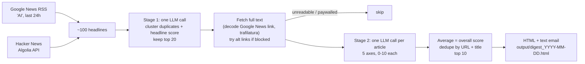

# News Digest

A small, daily **AI news digest** that uses an LLM as a judge. Every morning it pulls the last 24 hours of AI headlines, throws away duplicates and filler, reads the full text of the promising ones, scores each article on five axes, and emails you the top 10.

It's also a worked example of the idea that **evaluating an LLM app doesn't have to be complicated**: 100 hand-labeled articles, a train/test split, and mean absolute error per axis were enough to tune the judge prompt and pick a model with evidence instead of vibes.

---

## How it works



In text form:

1. **Fetch** - Google News RSS search for "AI" and Hacker News stories from the last 24 hours.
2. **Stage 1 (cheap, headline-only)** - a single LLM call groups near-duplicate headlines into one story (remembering the other outlets as *alt links*), scores each story 0-10 from the headline, and returns a shortlist of 20.
3. **Read** - for each shortlisted story, resolve the Google News redirect to the real publisher URL and extract the article with `trafilatura`. If the primary link is paywalled or blocked, try the alt links from other outlets.
4. **Stage 2 (careful, full-text)** - one LLM call per readable article scores it 0-10 on five axes (first 4,000 characters of text). The overall score is the plain average.
5. **Dedupe + rank** - a final pass drops any story that appears twice (same resolved URL, or near-identical normalized title), then keeps the top 10.
6. **Deliver** - render a mobile-friendly HTML email (plus a plain-text version), save a copy to `output/`, and send it via Gmail SMTP.

## The 5-axis rubric

Each article is scored 0-10 on:

| Axis | What it measures |
|---|---|
| **Scale** | How significant the development is for the AI industry. Near 0 if the article isn't really about an AI development. |
| **Relevance** | Relevance to AI/LLM evaluation broadly: LLM-as-judge, benchmarks, model reliability, safety evaluation, trustworthiness. |
| **Major lab** | Whether a frontier lab (OpenAI, Anthropic, Google/DeepMind, Meta, Amazon) is central; other big AI players are capped around 5-7. |
| **Preference** | How much this particular reader would want to read it (new models, novel use cases, capability gaps, AI security incidents, eval news high; generic policy, stock takes, celebrity stories low). |
| **Substance** | How much concrete, new, on-topic information is there. Defaults low; 7+ is reserved for articles that teach a genuinely new fact about an AI system or method. |

**Overall = mean of the five axes.** The exact wording lives in `SCORE_PROMPT` in [`score_articles.py`](score_articles.py). The reader profile is a data scientist who works on LLM evaluation, so change the prompt if your interests differ (and re-run the evaluation if you do).

## How the judge was evaluated

The goal: does the LLM judge score articles the way a human would?

1. **Collect** - `collect_training_data.py` was run daily until it had **100 readable articles**, drawn from the *full* candidate pool (not just the shortlist) so the set includes junk as well as good stories.
2. **Label** - every article was hand-scored 0-10 on the same five axes.
3. **Split** - **50 train / 50 test**. The prompt was only ever tuned by looking at the training set; the test set was held out for the final numbers.
4. **Metric** - **mean absolute error (MAE) per axis** between model and human scores, then the average of the five axis MAEs. Lower is better; 1.6 means the judge is typically about 1.6 points off a human on a 0-10 scale.

### Results (test set, n=50)

**Prompt tuning, same model (Gemini Flash-Lite):** overall test MAE went from **2.10 → 1.61** with the tuned prompt. Among other changes, the tuned prompt tells the judge not to give generous middle scores to articles that only mention AI in passing, and to default *Substance* low.

**Tuned prompt, different models:**

| Model | Test MAE (overall) |
|---|---|
| Claude Sonnet 5 | **1.55** |
| Gemini Flash-Lite | 1.61 |
| GPT-5.1 | 1.66 |

Caveats: one run per model. Re-running the same model on the same data moved the overall MAE by about **0.08**, so the three models are close to within noise of each other.

### Production model choice

The daily digest uses **Gemini Flash-Lite** (`gemini-flash-lite-latest`) first. It runs on Google's free API tier, and its test MAE (1.61) is within noise of the best model tested (Claude Sonnet 5, 1.55). If Flash-Lite is out of quota or unavailable, the digest falls back to Gemini Flash (`gemini-flash-latest`), then GPT-5.1. This production order is defined in `PRODUCTION_GOOGLE_MODELS` / `call_production()` in [`judge_client.py`](judge_client.py). The evaluation scripts keep their own default order, so their behavior hasn't changed.

Raw logs from the tuning and comparison runs are in [`results/`](results/).

## What each script does

| File | Purpose |
|---|---|
| `run_digest.py` | **Main entrypoint.** Runs the whole pipeline, dedupes, saves `output/digest_YYYY-MM-DD.html` (+ `.json`) and sends the email. `--no-send` skips the email. |
| `email_digest.py` | Renders the HTML and plain-text email and sends it through Gmail SMTP (SSL, port 465). |
| `fetch_news.py` | Fetches candidate headlines from Google News RSS and Hacker News. |
| `rank_news.py` | Stage 1: one LLM call to cluster duplicate headlines and shortlist the top 20. |
| `article_text.py` | Resolves Google News redirect links and extracts article text with trafilatura; anything under 200 characters counts as unreadable. |
| `score_articles.py` | Stage 2: the tuned 5-axis scoring prompt and parser (also runnable on its own to print a console digest). |
| `judge_client.py` | LLM calls with fallback (Gemini → GPT), plus single-model callers for head-to-head comparisons. |
| `collect_training_data.py` | Builds the evaluation pool: saves article text to `training_pool.jsonl` and appends blank rows to `labels.csv` for hand-labeling. |
| `evaluate.py` | Scores the labeled articles with the current prompt and reports MAE and correlation per axis (`python evaluate.py labels_train.csv` for the training set). |
| `compare_models.py` | Runs the same tuned prompt on several models against the test set and prints a comparison table. |
| `rerun_eval.py` | A resumable, single-model re-run of the test-set evaluation with a response cache, for when free-tier quotas stop a run partway. Writes to `results/`. |
| `stage2_checkpoint.py` | An early diagnostic: how many shortlisted articles are actually readable. |

## Setup

You'll need Python 3.11+ (developed on 3.13) and API keys for Gemini (free tier is enough) and OpenAI (used only as a fallback). An Anthropic key is only needed for the evaluation scripts.

```bash
git clone https://github.com/<you>/News-Digest.git
cd News-Digest
python -m venv .venv
# Windows:  .venv\Scripts\activate
# macOS/Linux:  source .venv/bin/activate
pip install -r requirements.txt
cp .env.example .env      # Windows: copy .env.example .env
```

Then open `.env` and fill in your values. It's in `.gitignore`, so it won't be committed.

| Variable | Needed for |
|---|---|
| `GOOGLE_API_KEY` | Gemini (main judge). Get one at Google AI Studio. |
| `OPENAI_API_KEY` | GPT-5.1 fallback. |
| `ANTHROPIC_API_KEY` | Only the evaluation scripts (Claude comparison). |
| `DIGEST_EMAIL_FROM` | The Gmail address that sends the digest. |
| `DIGEST_EMAIL_TO` | Where to send it (comma-separate several addresses). |
| `GMAIL_APP_PASSWORD` | An app password for the sending Gmail account (see below). |

## Running locally

```bash
python run_digest.py --no-send   # build the digest, save output/digest_YYYY-MM-DD.html, don't email
python run_digest.py             # build and email it
```

Open the saved HTML file in a browser to preview the email. If the email variables aren't set, the script still saves the HTML and prints a message saying it skipped sending. A run takes a few minutes, mostly spent fetching articles.

## Deploying with GitHub Actions (free daily email)

The workflow in [`.github/workflows/daily-digest.yml`](.github/workflows/daily-digest.yml) runs every day at **14:00 UTC** (7 AM US Pacific during daylight time, 6 AM in winter), and you can also start it by hand from the **Actions** tab ("Run workflow"). Each run uploads the HTML digest as a downloadable artifact.

1. Push this repo to GitHub.
2. Go to **Settings → Secrets and variables → Actions → New repository secret** and add:
   - `GOOGLE_API_KEY`
   - `OPENAI_API_KEY`
   - `ANTHROPIC_API_KEY` (optional; the daily digest doesn't use it)
   - `DIGEST_EMAIL_FROM`
   - `DIGEST_EMAIL_TO`
   - `GMAIL_APP_PASSWORD`
3. Open the **Actions** tab, enable workflows if GitHub asks, and run **Daily AI news digest** once by hand to check it works.

Notes:
- To change the send time, edit the `cron` line (it's always in UTC).
- GitHub pauses scheduled workflows in repositories with no activity for 60 days. Re-enable it from the Actions tab if that happens.
- In a public repo, the uploaded digest artifacts can be downloaded by other people. They only contain headlines, links and scores.

### Creating a Gmail app password

Gmail won't accept your normal password over SMTP. Create an app password instead:

1. Turn on **2-Step Verification** for the sending Google account (Google Account → Security).
2. Go to **Google Account → Security → 2-Step Verification → App passwords** (or search "App passwords" in your Google Account settings).
3. Create one (name it e.g. "News Digest"). Google shows a 16-character password once.
4. Put it in `GMAIL_APP_PASSWORD`. Spaces don't matter.

Consider using a separate Gmail account just for sending.

## What's not included

- **The labeled dataset is not in this repo.** `training_pool.jsonl` contains the full text of scraped news articles, which belongs to the publishers. `labels*.csv` are one person's subjective labels. Both are in `.gitignore`. To reproduce the evaluation, run `collect_training_data.py` to build your own pool, label `labels.csv` yourself, and split it into `labels_train.csv` / `labels_test.csv`.
- The logs in `results/` contain article IDs, headlines, scores and model reasons, but no article text.
- Generated digests (`output/`) aren't committed.

## The paywall philosophy

If an article can't be read for free, it doesn't go in the digest. A failed extraction (paywall, bot block, teaser-only page under 200 characters) is treated as a **filter, not an error to work around**. The pipeline does try other outlets covering the same story (the alt links from stage 1), so a big story usually still gets in through a free source. There's no paywall circumvention, and nothing gets scored from a headline alone. A digest is only useful if you can click through and read what it recommends.

## License

See [LICENSE](LICENSE).
